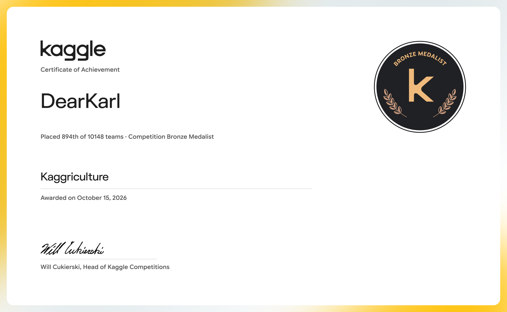

# Kaggriculture

### Kaggle Bronze Medal Solution

**894th of 10,148 teams · Top 8.81% · Final score 4419.2**

Opponent-conditioned market execution with state-signature detection and constrained purchase rescheduling.

[Competition](https://www.kaggle.com/competitions/kaggriculture) · [Final Leaderboard](https://www.kaggle.com/competitions/kaggriculture/leaderboard?search=We+Forgot+To+Water) · [Official Certificate](https://www.kaggle.com/certification/competitions/dearkarl/kaggriculture) · [Technical Walkthrough](docs/METHOD.md)

## Competition Result

**We Forgot To Water** earned a **Competition Bronze Medal** in Kaggriculture. This repository presents our selected submission, its source code, and the strategy behind its opponent-aware trading layer.

| Achievement | Result |
| --- | --- |
| Final placement | **894 / 10,148 teams — Top 8.81%** |
| Final leaderboard score | **4419.2** |
| Award | **Kaggle Competition Bronze Medal** |
| Team | **We Forgot To Water** |
| Members | [Shuang Xue](https://www.kaggle.com/shuangxue) · [DearKarl](https://www.kaggle.com/dearkarl) |
| Award date | October 15, 2026 |

The certificate is issued to DearKarl; the placement and score are team results. [Result evidence and submission details →](docs/ARCHIVE.md#competition-result-and-selected-submission)

## The Challenge

Kaggriculture is a competitive farming simulation in which agents manage workers, crops, livestock, storage, and market orders to maximize income. Production planning determines what the farm can trade; market timing determines the value of those trades. An opponent's predictable purchases create an opportunity to adjust when our own planned purchases execute.

## Strategy: Opponent-Conditioned Market Execution

**Turn observable opponent behavior into selective, actionable market predictions.**

Our selected submission, `our__fr-router`, integrates farm-state signature detection, conditional opponent modeling, and constrained purchase rescheduling. The trading layer uses an inferred opponent plan to decide when to advance an already scheduled purchase, while the production controller coordinates farm operations.

### Technical Approach

| Mechanism | Implementation | Design rationale |
| --- | --- | --- |
| **State-signature detection** | Encode visible crop, planting-day, livestock, and tile-state features; compare them against reference signatures at steps **24, 48, and 72**. | Identify matchups where a reference action schedule is a plausible opponent model. |
| **Conditional opponent modeling** | Enable the reference plan after a signature match; clear and lock the detector if a later checkpoint contradicts that match. | Make the use of opponent predictions depend on observable evidence. |
| **Constrained purchase rescheduling** | Advance overlapping planned purchases by **one step**, with quantities bounded by planned demand, estimated affordability, and available storage. | Seek earlier execution before predicted competing demand affects prices. |
| **Temporal order accounting** | Track quantities scheduled for early purchase and deduct them from the corresponding later buy orders. | Coordinate current orders with future purchase commitments. |
| **Production–execution integration** | Couple the trading layer to shop- and phase-dependent farming routes and reactive controls. | Coordinate purchase timing with the farm's production schedule. |

### Submission-Level Contribution

The contribution highlighted by this submission is the integration of **opponent recognition, a prediction gate, and buy-side timing control** into the agent's decision process:

1. **Matchup-dependent execution.** A farm-state match enables the opponent plan; without that match, the early-buy logic does not use the plan.
2. **Timing adjustment within planned demand.** The layer targets purchases already scheduled by our route and overlapping with the predicted opponent's demand.
3. **Explicit resource and order accounting.** Local cash and storage bounds limit proposed early orders, while a purchase ledger adjusts subsequent orders.

The intended edge is better execution timing against opponents whose behavior matches the reference family. The reported bronze-medal result belongs to the complete submitted agent; implementation details and component-level evidence are documented in the [technical walkthrough](docs/METHOD.md).

## Code and Documentation

| Resource | Description |
| --- | --- |
| [Agent source](src/main.py) | The submitted policy, with its original source and credits preserved. |
| [Kaggle submission](submission/submission.tar.gz) | The single selected submission archive. |
| [Technical walkthrough](docs/METHOD.md) | Strategy details, code references, and evaluation context. |
| [Results and archive guide](docs/ARCHIVE.md) | Score evidence, repository contents, integrity checks, and reproduction scope. |

The policy entry point is `agent(observation, configuration=None)`. For download and verification instructions, see the [archive guide](docs/ARCHIVE.md#download-and-verify).

## Acknowledgments

[Apache-2.0 License](LICENSE) · [Source Attribution](NOTICE.md)
