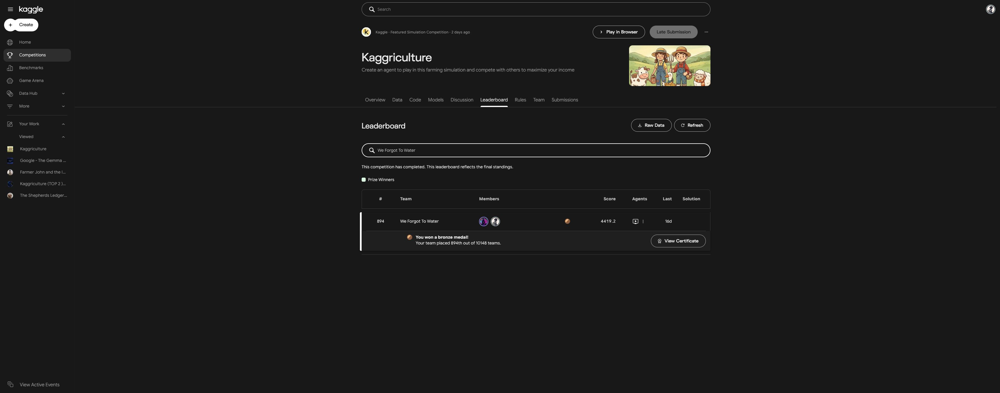
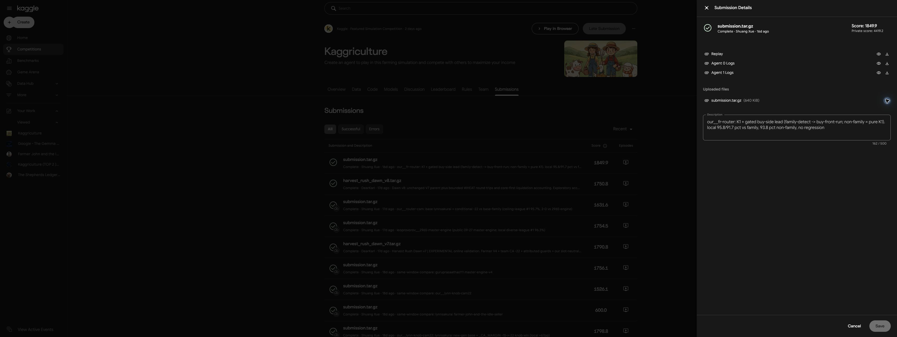

# Results, Archive, and Verification

This guide records the evidence behind the project's result, the files preserved in the repository, and what can be verified locally. For the strategy itself, see [Method and Evidence](METHOD.md).

## Competition Result and Selected Submission

| Field | Recorded value |
| --- | --- |
| Competition | Kaggriculture |
| Team | We Forgot To Water |
| Members | Shuang Xue and DearKarl |
| Final rank | 894 / 10,148 teams |
| Placement | Top 8.81%, calculated as 894 / 10,148 × 100 |
| Medal | Competition Bronze Medal |
| Final leaderboard score | 4419.2 |
| Selected submission | `submission.tar.gz` / `our__fr-router` |
| Submitted by | Shuang Xue |
| Submitted at | September 30, 2026, 23:15:59 UTC |
| Public score displayed | 1849.9 |
| Private score displayed | 4419.2 |
| Certificate holder | DearKarl |
| Certificate award date | October 15, 2026 |
| Kaggle result verified | October 17, 2026 |

The selected submission's private score matches the team's final leaderboard score. The public score of 1849.9 and final score of 4419.2 are distinct Kaggle score fields; their difference is not an estimate of the improvement from our strategy. Older submissions displayed higher historical public scores. This repository preserves the user-selected final-result version, rather than the historical public-score maximum.

Authoritative links:

- [Competition](https://www.kaggle.com/competitions/kaggriculture)
- [Final leaderboard filtered to We Forgot To Water](https://www.kaggle.com/competitions/kaggriculture/leaderboard?search=We+Forgot+To+Water)
- [DearKarl's official certificate](https://www.kaggle.com/certification/competitions/dearkarl/kaggriculture)
- [Team submissions page](https://www.kaggle.com/competitions/kaggriculture/submissions) — requires the appropriate Kaggle account access.

### Competition Context and Participation Counts

The [official competition overview](https://www.kaggle.com/competitions/kaggriculture/overview) describes two-player matches lasting 30 game days (720 turns) and final evaluation through a Bradley–Terry tournament. The final leaderboard and certificate support the denominator of 10,148 teams used for this project's placement.

Entrants, individual participants, and teams are different counts, and figures captured before the deadline may differ from final standings. This project uses the final team count; it makes no historical-largest or most-participants claim, since a comprehensive official comparison as of the deadline has not been established.

### Certificate

The original certificate image supplied by DearKarl is preserved unchanged. It records the individual certificate holder and the team's placement and medal.


### Final Leaderboard



### Submission Details



## Repository Contents

```text
kaggriculture/
├── README.md                         # Project showcase and strategy overview
├── LICENSE                           # Apache-2.0 text from the submitted source
├── NOTICE.md                         # Attribution and available upstream sources
├── assets/
│   └── kaggle-bronze-certificate.png  # Original certificate supplied by DearKarl
├── src/
│   └── main.py                       # Unchanged extracted agent source
├── submission/
│   └── submission.tar.gz             # Original selected Kaggle download
├── docs/
│   ├── METHOD.md                     # Technical strategy walkthrough
│   ├── ARCHIVE.md                    # This guide
│   ├── provenance.json               # Scores, sources, sizes, and SHA-256 records
│   ├── leaderboard.png               # Final leaderboard evidence
│   └── submission-details.png        # Submission-detail evidence
└── tools/
    └── verify_archive.py             # Integrity and syntax verifier
```

Only one submission version is included. `src/main.py` is an extracted view of the same submission, not a second policy. It contains 10,311 lines, including inherited routes, controller layers, encoded data, and original notices. Its bytes and line endings have been preserved.

The repository also includes `.gitignore` and `.gitattributes`. The latter disables text normalization for the archived source so that Git preserves its original bytes.

## Download and Verify

Python 3 is required for the verifier; it uses only the standard library.

```bash
git clone https://github.com/DearKarl/kaggriculture.git
cd kaggriculture
python3 tools/verify_archive.py
```

The verifier checks:

1. The original archive and extracted source match the sizes and SHA-256 hashes in [provenance.json](provenance.json).
2. The archive contains exactly one member, `main.py`.
3. The extracted source is byte-identical to the file in the archive.
4. Python can compile the source without syntax errors, without executing it.

The certificate's SHA-256 is recorded separately in `provenance.json`; the verifier currently checks the submission archive and source, not the certificate or screenshots.

### Using the Policy

The entry point is `agent(observation, configuration=None)` in [src/main.py](../src/main.py). The original [submission.tar.gz](../submission/submission.tar.gz) retains `main.py` at the archive root for environments supporting that submission format.

There is no standalone match runner in this repository. The recovered replay identifies environment module version `1.32.7`; the historical runnable environment and evaluation harness have not been reconstructed. A fresh clone can verify the artifact and view the recorded match; it does not by itself recreate the original competition environment or final rating.

## Evaluation Evidence and Limits

The original submission description reads:

> our__fr-router: K1 + gated buy-side lead (family-detect -> buy-front-run; non-family = pure K1). local 95.8/91.7 pct vs family, 93.8 pct non-family, no regression

This is a historical team note, preserved in [provenance.json](provenance.json). Raw logs, seeds, denominators, metric definitions, and the separate K1 baseline artifact were not recovered. The percentages and `no regression` statement therefore remain unverified local evaluation claims, rather than independently established win rates or ablation findings.

The official final result supports the performance of the complete submitted agent. It does not isolate gains from the detector, early-buy logic, or individual inherited layers. Fixed opponent signatures may also be sensitive to a changed opponent population. [METHOD.md](METHOD.md) explains these implementation and evidence boundaries.

## Attribution and Preservation

The archive and extracted source have not been rewritten for presentation. Their embedded Apache-2.0 license and historical credits remain intact. The root [LICENSE](../LICENSE) reproduces the embedded license text; [NOTICE.md](../NOTICE.md) summarizes identifiable contributors and available sources, including the limits of recovered attribution material.

## Replay and Strategy Visuals

The repository also includes an [official match replay showcase](REPLAY.md), the complete compressed episode JSON and metadata in `assets/replays/`, a sampled schematic GIF in `assets/replay-preview.gif`, and a Pillow-based renderer in `tools/render_replay.py`. These assets preserve recorded gameplay; they do not represent a new evaluation.

The [strategy flow](../figures/strategy-flow.md) is available as editable Mermaid (`.mmd`), a Markdown wrapper, and a rendered PNG in `figures/`. It illustrates the family-gated early-buy layer and its no-match branch.
