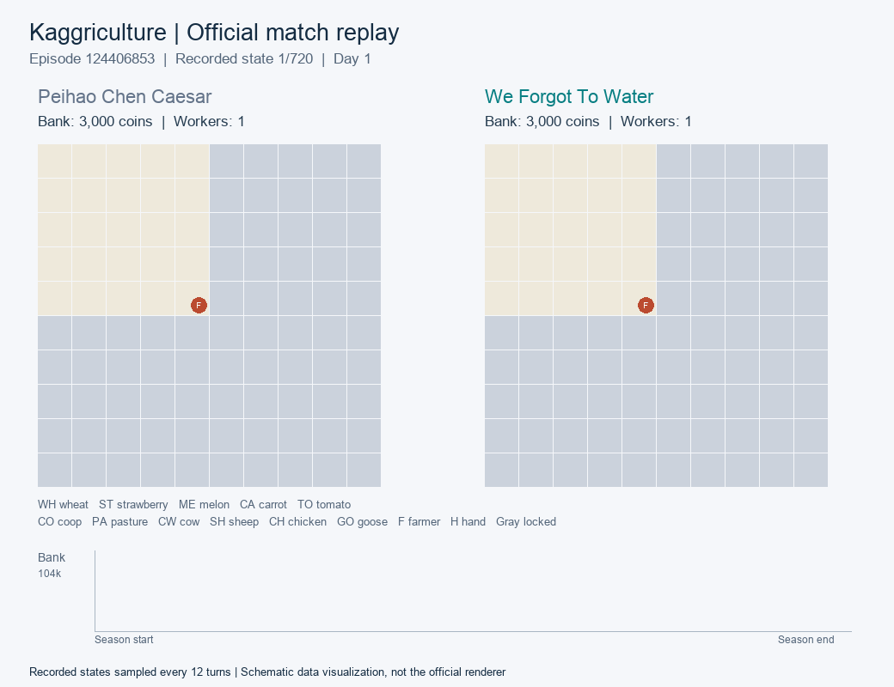

# Official Match Replay

This showcase uses a real Kaggle episode associated with our selected `our__fr-router` submission. It was downloaded through the submission's **View episodes** history and **Download replay** control. The preview is reconstructed from recorded states; it does not run the agent or generate a new match.



## Match Record

| Field | Value |
| --- | --- |
| Episode ID | `124406853` |
| Our submission ID | `56721178` |
| Our team | We Forgot To Water |
| Our seat | 1 (zero-based; right board in the preview) |
| Opponent | Peihao Chen Caesar |
| Final bank — our team | **99,176 coins** |
| Final bank — opponent | **98,889 coins** |
| Match result | **Win by 287 coins** |
| Recorded states | 720 |
| Episode seed | `2085363426` |
| Environment module version recorded in replay | `1.32.7` |

[Open episode history on Kaggle](https://www.kaggle.com/competitions/kaggriculture/submissions?submissionId=56721178&episodeId=124406853) — the submissions view may require account access.

[Download the compressed original replay](../assets/replays/124406853.json.gz) · [Replay metadata and hashes](../assets/replays/124406853.metadata.json)

## How the Preview Was Made

The GIF samples the full season every 12 turns and includes the final recorded state. Its 61 frames show both farms, crop and animal tile labels, farmer/hand positions, bank balances, and bank trajectories. The last frame is held to show the outcome.

The board graphics are a schematic visualization created for this repository, not a recording of Kaggle's official renderer. All displayed farm states and balances come from the downloaded episode. Intermediate turns are omitted from the preview; the compressed replay retains the complete original JSON.

The match was the most recent episode displayed when opening the selected submission's history. It was not chosen by searching for the largest winning margin. The adjacent history also included losses. This single match illustrates the agent's behavior and is not an estimate of aggregate win rate or proof that a particular component caused the win. No internal detector or early-buy activation is inferred from the preview alone.

## Regenerate the Preview

The renderer requires Python 3 and Pillow:

```bash
python3 -m pip install Pillow
python3 tools/render_replay.py assets/replays/124406853.json.gz assets/replay-preview.gif
```

The script reads the replay and draws its states. It makes no network calls and does not execute the submitted policy.

## Verify the Download

`124406853.metadata.json` records SHA-256 hashes of the original uncompressed JSON and the preserved gzip file. The replay header's episode ID, team names, rewards, state count, and module version were checked against the showcase metadata. These are match-level records, distinct from the competition's final rating of 4419.2.
